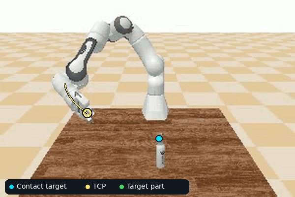

# Part2Action

Part2Action predicts robot actions from visual observations, robot state, and
instructions naming an object part. Training uses PartInstruct demonstrations;
closed-loop evaluation uses the PartGym Franka Panda environment.



PartInstruct expert demonstration illustrating part-aware manipulation. Cyan
marks the derived interaction target, yellow shows the recorded TCP and recent path,
and green highlights the target part. These overlays come from demonstration
data rather than model predictions.

This README describes the model and implementation. The repository
[README](../README.md) provides the wider project overview. Read
[RESEARCH_PLAN.md](docs/RESEARCH_PLAN.md) for current decisions/results,
[SETUP.md](docs/SETUP.md) for paths/environments/commands, and
[DATASET.md](docs/DATASET.md) for annotations and split definitions.

## Inputs and outputs

At deployment the policy receives RGB, the full scene point cloud, the task
sentence, the TCP pose, and measured gripper opening. Current recipes exclude
joint angles. Dataset part masks, target-part clouds, and per-step skill labels
provide training supervision; they are not deployment inputs.

The model predicts an **8 × 7 action chunk**:

```text
world x, world y, world z, roll, pitch, yaw, gripper
```

Current rollouts execute the first action, observe the scene again, and predict
another chunk. The contact head separately predicts a 3D location on the scene
cloud. Its influence on actions depends on the architecture variant.

The gripper action is a per-finger position target in meters: 0 closes and 0.04
opens. Rollouts bound this component to [0, 0.04] immediately before execution,
for both MLP and diffusion outputs. Logs retain raw predictions, executed
commands, and measured finger position. The gripper remains included in action
training; bounding does not add a separate gripper loss or change checkpoints.

## Shared architecture

- Frozen DINOv2 ViT-S/14 with register tokens encodes RGB; frozen Flan-T5-base
  encodes task language.
- A learned hierarchy predicts skill slots, selects the current skill from
  observations/state, and predicts termination.
- A learned visual part gate reweights visual tokens; its skill-conditioning
  option is disabled in current recipes. Ground-truth masks
  supervise that prediction; predicted gating influences the policy features.
- Point-cloud features and contact attention predict a world-frame contact point.
- A diffusion action head predicts the chunk with a two-layer/four-head
  Transformer denoiser and pooled observation/skill context. A separate temporal
  Transformer processes two consecutive observation frames. The original action decoder
  is retained in both pose paths.

The original visual checkpoint and its configuration remain available for
initialization and comparison. Earlier architecture descriptions are historical;
the two supported pose paths below define current work.

## Supported pose architectures

The [config index](configs/README.md) identifies the three current recipes:
the original visual baseline and the two pose paths. Older recipes are archived;
one compatibility symlink preserves frozen-tooling defaults. Configs select
settings, Python defines the computation, and checkpoints store learned weights.

Two paths retain the original RGB/scene/state/language Transformer diffusion
policy. Neither uses a separate small action controller.

| Path | Implementation | Status |
| --- | --- | --- |
| Original visual policy + supplied GT grasp pose | `models/visual_pose_policy_v1.py`, `scripts/run_visual_oracle_pose_v1.py` | GPU checks passed; fine-tuning pending GPU priority; evaluation queued behind it |
| Shared visual grounding + predicted grasp pose | `models/grounded_visual_pose_policy_v1.py`, `scripts/train_grounded_visual_pose_v1.py` | Implemented; 15 CPU/regression checks and GPU smoke 6865392 passed; full training not submitted |

The [GT-stage diagram](docs/figures/2026-11-10_visual_gt_pose_finetuning/visual_gt_pose_finetuning.pdf)
shows its matched control. The [current two-path diagram](docs/figures/2026-11-11_grounded_visual_pose/visual_pose_architectures.pdf)
compares supplied versus predicted pose conditioning.

In the new path, shared skill-conditioned grounding weights pool local observed
geometry. A geometry/skill query attends to visual tokens; those features plus
measured TCP/opening predict target TCP position, orientation and applicability.
The differentiable pose-conditioning MLP feeds the original action decoder.
Global visual, scene, history and skill context continue directly to that decoder.
Contact XYZ and part labels supervise grounding; there is no independent contact
coordinate-to-action input. Unused heatmap/approach/contact-token heads are
omitted in this version. The original checkpoint's learned constant bias is
preserved for initialization equivalence.

DINO/T5 remain frozen. Existing trainable policy layers fine-tune; the new pose
head starts with newly initialized weights. Pose labels are valid during the
first-grasp approach only, while all demonstration frames still train actions.
Runtime uses predictions from observations and inferred skills. No GT pose,
GT part cloud, reference clock or replay commands enter that deployment path.

[Recipe](configs/pose_learning/grounded_visual_pose_v1.yaml),
[setup](docs/SETUP.md#shared-visual-grounding-and-predicted-pose--november-11),
[research plan](docs/RESEARCH_PLAN.md),
[active GT run](../results/diagnostics/visual_oracle_pose_20261110_01/README.md),
[new architecture preflight](../results/diagnostics/grounded_visual_pose_20261111_01/README.md).

At the user's request, the non-visual pose/controller pipeline is retired and its
eight result roots, including trained models and rollout metrics, were deleted.
Dedicated source/config/test/figure files remain only in a source archive;
unused modules fingerprinted by the queued GT experiment remain unchanged to
preserve that run's integrity. [Cleanup receipt](docs/cleanup_20261111_nonvisual_pose.json).

## Dataset and evaluation

The full released dataset contains 11 categories at
`/p/part2action/data/PartInstruct`. Current trained variants use only bottle,
mug, pliers, and scissors, with train/test separation and no held-out validation
split. Training losses and offline training-data checks are not test success rates.

All four variants completed 30 epochs and passed five-action H100 smoke tests on
2026-10-08. From October 12, evaluation covers **all 149 test1 scenarios**
across 32 object/task combinations for these four objects, once each per fixed
evaluation seed42,43,44 (447 rollouts per model), with explicit scenario selection.
Report per-seed success and its mean and sample standard deviation. It uses a 120-step limit,
legacy learned termination, and one action executed per policy cycle.
Point-cloud sampling uses deterministic PyTorch3D CPU FPS; policy inference uses
GPU. Detailed progress and job IDs belong in the research plan. The current GT-pose
study has zero policy rollouts so far; 333/339 native grasp references are
available, and the remaining six are coverage gaps.

Released PartInstruct DP-S/DP3-S weights are downloaded and their native
GT-part/oracle-skill evaluations completed. Those 176 sampled trials per model
are separate from our 447 fixed-scenario comparison. Earlier self-trained DP/DP3
runs and the five-trial scissors pilot are historical; they are not evaluations
of the author-released weights. See the research plan for comparison limitations.

## Implementation layout

```text
part2action/
  configs/                    Experiment recipes and module flags
  data/                       HDF5 loading, coordinate transforms, target derivation
  models/                     Encoders, fusion, hierarchy, contact and action heads
  diagnostics/                Rollout diagnostic helpers
  scripts/
    train.py                  Offline training
    evaluate.py               Offline metrics
    rollout_partgym.py        Closed-loop simulator evaluation
    submit_evaluation_comparison.py  Matched rollouts with automatic GIF comparison
    export_evaluation_gifs.py Flat GIF review with any number of policy panels
    register_result.py        Register external outputs in root results/
  slurm/                      Batch launchers and GPU smoke checks
  tests/                      Geometry, conditioning, gate, and action checks
  docs/                       Research plan, setup, dataset, slides and archives
  storage -> /p/part2action    Dataset, caches, environments, heavy outputs, logs
```

The framework clone is [../PartInstruct/](../PartInstruct/). Outputs are indexed
under root [../results/](../results/README.md); source/configs and small reports
remain in the repository. Follow that guide for new experiments.

## Results

- [Diffusion comparison](../results/part2action/evaluations/diffusion_30epoch_20261013/index.html): 447 combined GIFs with expert reference left, historical MLP control, diffusion control, and diffusion contact. Future experiments use diffusion heads.
- [Archived MLP experiments](../results/part2action/archive/mlp/README.md): earlier checkpoints, evaluations, and policy diagnostics.
- [DP3 success GIFs](../results/partinstruct/visualizations/dp3_success/) and
  [failure GIFs](../results/partinstruct/visualizations/dp3_failures/).
