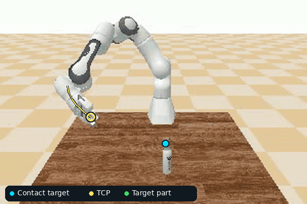

# Part2Action

Part2Action predicts robot actions from visual observations, robot state, and
instructions naming an object part. Training uses PartInstruct demonstrations;
closed-loop evaluation uses the PartGym Franka Panda environment.



PartInstruct expert demonstration illustrating part-aware manipulation. Cyan
marks the derived interaction target, yellow shows the recorded TCP and recent path,
and green highlights the target part. These overlays come from demonstration
data rather than model predictions.

This README describes the model and implementation. The repository
[README](../README.md) provides the wider project overview. Read
[RESEARCH_PLAN.md](docs/RESEARCH_PLAN.md) for current decisions/results,
[SETUP.md](docs/SETUP.md) for paths/environments/commands, and
[DATASET.md](docs/DATASET.md) for annotations and split definitions.

## Inputs and outputs

At deployment the policy receives RGB, the full scene point cloud, the task
sentence, the TCP pose, and measured gripper opening. Current recipes exclude
joint angles. Dataset part masks, target-part clouds, and per-step skill labels
provide training supervision; they are not deployment inputs.

The model predicts an **8 × 7 action chunk**:

```text
world x, world y, world z, roll, pitch, yaw, gripper
```

Current rollouts execute the first action, observe the scene again, and predict
another chunk. The contact head separately predicts a 3D location on the scene
cloud. Its influence on actions depends on the architecture variant.

The gripper action is a per-finger position target in meters: 0 closes and 0.04
opens. Rollouts bound this component to [0, 0.04] immediately before execution,
for both MLP and diffusion outputs. Logs retain raw predictions, executed
commands, and measured finger position. The gripper remains included in action
training; bounding does not add a separate gripper loss or change checkpoints.

## Shared architecture

- Frozen DINOv2 ViT-S/14 with register tokens encodes RGB; frozen Flan-T5-base
  encodes task language.
- A learned hierarchy predicts skill slots, selects the current skill from
  observations/state, and predicts termination.
- A learned visual part gate reweights visual tokens; its skill-conditioning
  option is disabled in current recipes. Ground-truth masks
  supervise that prediction; predicted gating influences the policy features.
- Point-cloud features and contact attention predict a world-frame contact point.
- A diffusion action head predicts the chunk with a two-layer/four-head
  Transformer denoiser and pooled observation/skill context. A separate temporal
  Transformer processes two consecutive observation frames. Earlier MLP action
  heads remain available as historical references.

The unified variants retain the hierarchy, part gate, and auxiliary contact
head. “Unified” refers to using the action policy throughout the motion without
switching XYZ commands at a contact-distance threshold.

## Historical architecture variants

The table below describes earlier methods, not the active experiment queue.
Current control/contact models both use Transformer diffusion, stride 1,
next-index targets, two frames and contact auxiliary supervision. Only explicit
contact conditioning changes. See the research plan for scores and job records.

| Variant | Observation history | How predicted contact coordinates affect actions |
| --- | --- | --- |
| Baseline | One frame | Auxiliary supervision; coordinates do not directly enter the action head or replace XYZ |
| Near-contact | Two frames | Within 3 cm, replace XYZ with predicted contact plus a bounded 3 cm offset; otherwise use MLP XYZ |
| Unified control | Two frames | Same conditioning projection as unified contact, supplied with zeros; no XYZ switching |
| Unified contact | Two frames | Feed predicted contact relative to the TCP into action features throughout motion; no XYZ switching |

Unified contact projects the detached vector
`(predicted_contact_world - TCP_world) / 0.1` into action features. It uses
predictions during both training and deployment. Ground-truth contact targets
remain auxiliary supervision. Contact confidence is not an implemented input.
The old bounded contact-relative action offset and residual are disabled in the
unified pair.

The near-contact training gate uses demonstration contact labels; rollout gating
uses predictions. The unified control/contact pair is the matched comparison for
explicit geometry conditioning. The original baseline also differs in temporal
history, so comparisons against it involve more than that single change.

Configs are under [configs/architecture_update/](configs/architecture_update/),
with names ending in `no_residual`, `near_contact`, `unified_control`, and
`unified_contact`. Model construction uses config flags; keep matched experiments
consistent outside the module being tested.

Matched unified diffusion control/contact configs are also available. They keep
the same observation and geometry-conditioning interfaces, with a normalized
100-step cosine DDPM decoder in place of the MLP. Training commands are in
[setup](docs/SETUP.md#train); current run records are in
[the research plan](docs/RESEARCH_PLAN.md).

## Dataset and evaluation

The full released dataset contains 11 categories at
`/p/part2action/data/PartInstruct`. Current trained variants use only bottle,
mug, pliers, and scissors, with train/test separation and no held-out validation
split. Training losses and offline training-data checks are not test success rates.

All four variants completed 30 epochs and passed five-action H100 smoke tests on
2026-10-08. From October 12, evaluation covers **all 149 test1 scenarios**
across 32 object/task combinations for these four objects, once each per fixed
evaluation seed42,43,44 (447 rollouts per model), with explicit scenario selection.
Report per-seed success and its mean and sample standard deviation. It uses a 120-step limit,
legacy learned termination, and one action executed per policy cycle.
Point-cloud sampling uses deterministic PyTorch3D CPU FPS; policy inference uses
GPU. Detailed progress and job IDs belong in the research plan.

Released PartInstruct DP-S/DP3-S weights are downloaded and their native
GT-part/oracle-skill evaluations completed. Those 176 sampled trials per model
are separate from our 447 fixed-scenario comparison. Earlier self-trained DP/DP3
runs and the five-trial scissors pilot are historical; they are not evaluations
of the author-released weights. See the research plan for comparison limitations.

## Implementation layout

```text
part2action/
  configs/                    Experiment recipes and module flags
  data/                       HDF5 loading, coordinate transforms, target derivation
  models/                     Encoders, fusion, hierarchy, contact and action heads
  diagnostics/                Rollout diagnostic helpers
  scripts/
    train.py                  Offline training
    evaluate.py               Offline metrics
    rollout_partgym.py        Closed-loop simulator evaluation
    submit_evaluation_comparison.py  Matched rollouts with automatic GIF comparison
    export_evaluation_gifs.py Flat GIF review with any number of policy panels
    register_result.py        Register external outputs in root results/
  slurm/                      Batch launchers and GPU smoke checks
  tests/                      Geometry, conditioning, gate, and action checks
  docs/                       Research plan, setup, dataset, slides and archives
  storage -> /p/part2action    Dataset, caches, environments, heavy outputs, logs
```

The framework clone is [../PartInstruct/](../PartInstruct/). Outputs are indexed
under root [../results/](../results/README.md); source/configs and small reports
remain in the repository. Follow that guide for new experiments.

## Results

- [Diffusion comparison](../results/part2action/evaluations/diffusion_30epoch_20261013/index.html): 447 combined GIFs with expert reference left, historical MLP control, diffusion control, and diffusion contact. Future experiments use diffusion heads.
- [Archived MLP experiments](../results/part2action/archive/mlp/README.md): earlier checkpoints, evaluations, and policy diagnostics.
- [DP3 success GIFs](../results/partinstruct/visualizations/dp3_success/) and
  [failure GIFs](../results/partinstruct/visualizations/dp3_failures/).
