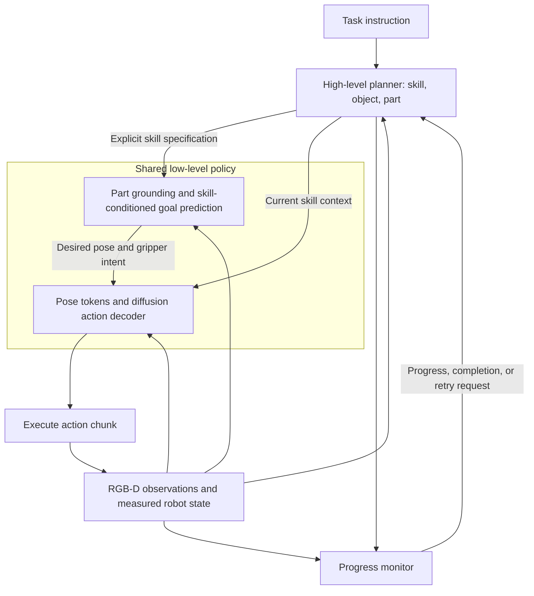

# Proposal: explicit skill planning with part-aware pose control

Created November 18, 2026. Project: **Part2Action / P2A**, Franka Panda in
PartGym with PartInstruct demonstrations. PAP/LRL is a separate project.

**Status: architecture proposal, separate from [RESEARCH_PLAN.md](RESEARCH_PLAN.md).**
This document records the structure discussed after reviewing GHOST and
PartInstruct. It is not an implementation report, a claim of improved task
success, or an established novelty claim. It does not change model code,
checkpoints, configurations, or job submissions.

**November 18 implementation follow-up:** the separately named
[`pose_token_diffusion_v3`](POSE_TOKEN_DIFFUSION_V3_ARCHITECTURE.md) now
implements the current-skill executor, training path, planner interface and
separate runtime. Initial executor training retains frozen DINOv2/T5 and uses
annotated current skills with predicted geometric goals. This does not establish
VLM planning or task-success performance. The proposal's experimental acceptance
criteria below remain in force; the main research plan is not promoted by this
implementation alone.

The earlier [skill-specific pose proposal](SKILL_SPECIFIC_POSE_PROPOSAL.md)
defines candidate pose targets and later part-consistency experiments. This
proposal focuses on the boundary between semantic planning and action execution.
Evidence from controlled experiments is required before merging either direction
into the main research plan.

## Motivation and research question

Can an explicit current-skill specification, combined with part-aware geometric
goals, improve skill execution and composition while making failures easier to
attribute to planning, grounding, goal prediction, control, or progression?

The current v2 policy already has a hierarchy: learned plan slots, phase
selection, a per-slot goal bank, and a diffusion action decoder. These components
share features and train together. The proposed change makes the semantic
interface explicit and independently testable; it does not introduce hierarchy
into a previously flat policy.

The first development evaluation found that both pilot checkpoints remained in
phase zero. A completion-label sampling defect was identified, and touch-only
tasks also failed. These observations motivate separate tests of execution and
progression. They do not establish that shared features or joint training are
inherently inferior. See the [initial development evaluation](../../results/diagnostics/pose_token_diffusion_v2_development_20261117_01/README.md)
and the separate [completion-supervision experiment](../../results/diagnostics/pose_token_diffusion_v2_completion_20261117_01/README.md).

## Lessons from the papers

| Source | Relevant mechanism | Proposed use here |
| --- | --- | --- |
| [PartInstruct, Section IV-B and Appendix D.3](https://arxiv.org/html/2505.21652v2) | A high-level VLM selects a part-specific skill instruction; a low-level policy executes that instruction. Low-level training uses skill-segmented demonstrations. | Use an explicit skill/object/part interface and evaluate execution independently of task planning. |
| [GHOST, Sections IV-C and V-C](https://arxiv.org/html/2606.10025v1) | A high-level model predicts end-effector subgoals; a separate diffusion policy uses projected goal heatmaps. The two policies train independently, and the goal is refreshed after each executed action chunk. | Give action generation an explicit geometric target and refresh it from new observations. Retain our pose-token interface as the initial implementation choice. |

This is a proposed synthesis, not an exact reproduction of either system.
PartInstruct's published planner refreshes skill instructions after estimated
skill durations; GHOST refreshes geometric subgoals at action-chunk boundaries.
Those are different update rules. Neither paper establishes that our particular
completion MLP is required.

Separate responsibilities also do not require completely independent networks.
[Pi 0.5, Section IV-A](https://arxiv.org/html/2504.16054) represents high-level
subtask prediction and low-level action generation within one model. We should
test interface choices and training coupling separately.

## Proposed structure

Use **two policy levels**. Part grounding and goal prediction belong inside
the low-level policy. A progress monitor supports the execution loop.



### High-level planner: choose the interaction

Inputs are the task instruction, observations, execution history, and progress
estimates. Output an explicit specification of the current skill, target object,
relevant part, intended outcome, and interaction requirement.

For example, a lift could be represented conceptually as:

```yaml
skill: move_gripper
object: observed_mug_0
target_part: handle
goal:
  type: relative_translation
  direction: up
  reference: skill_start
interaction: maintain_grasp
```

The object identifier refers to a perceived/tracked object, not a hidden
simulator asset ID. This schema is illustrative and is not implemented.
The planner chooses the interaction; it does not generate motor commands.

Initially hold the high-level planner fixed while comparing low-level policies.
Its model choice, prompt/schema, and version must be pinned before implementation.
Existing DINOv2/T5 encoders alone do not constitute a pretrained task planner.

### Low-level policy: realize the interaction

Use **one shared policy across skills**, rather than a complete model per skill.
Retain the current visual/scene observation paths, measured TCP/opening inputs,
pose tokens, and transformer diffusion decoder as the initial controlled design.
Visual context remains available to both grounding/goal prediction and action
generation. The current skill specification is an explicit conditioning input.

The geometric module grounds the requested part and predicts a desired robot
goal appropriate to the skill:

| Skill | Geometric goal and interaction intent |
| --- | --- |
| Grasp | Approach position/orientation at the intended part, followed by closure intent. |
| Touch | A contact-related position, applicable orientation constraints, and the task's required gripper state. PartGym's native touch definition requires closed fingertips. |
| Move/lift | A displacement referenced to the skill start, with holding intent when required. |
| Rotate | A desired reorientation and compatible robot motion; an object/part orientation must not be equated with TCP orientation without a validated mapping. |
| Place/release | An appropriate placement target and opening intent; reaching an endpoint does not establish support or successful release. |

Keep position, orientation, and gripper intent distinct, with component
applicability and confidence. Current v2 labels include fingertip-distance and
TCP-endpoint proxies; they are not verified physical contact/retention labels.

A **pose estimator** estimates current object/part geometry. A **goal predictor**
selects a desired robot configuration. They have different roles. A future
estimator can feed the geometric module without replacing visual action
conditioning or directly overriding the decoder's actions.

### Progress monitor and update rules

Distinguish three decisions:

1. **Action update:** predict and execute a new action chunk.
2. **Geometric refresh:** update the current skill's goal using the new scene.
3. **Semantic transition:** select a different skill, retry, or revise the plan.

Start with the established eight-command execution cadence. Refresh the
geometric goal after each executed chunk while preserving the current semantic
intent. A geometric refresh does not automatically advance the skill.

Retain a skill-start reference when the outcome is relative motion. Repeatedly
setting a lift target to current height plus a fixed offset would move the
destination indefinitely. Goal refinement should preserve the intended outcome.

The progress monitor uses observable robot/scene information and the active
specification. It may be learned and should be evaluated independently. Request
high-level review at bounded intervals and when progress is uncertain or stalled.
A timeout requests reassessment or retry; it is not evidence of completion.
Planner review is not itself a reliable physical success detector.

Completion signals need validated skill-specific definitions. Pose proximity
alone does not establish grasp, touch, retention, or placement. Simulator
predicates remain evaluation labels/scores and do not silently enter deployed
policy inputs or phase advancement.

## Difference from the current v2 implementation

| Aspect | Current v2 baseline | Proposed experiment |
| --- | --- | --- |
| Semantic interface | Learned latent plan slots generated from the task instruction. | Explicit current skill, object, part, and intended interaction. |
| Goal selection | Predict a bank of slot goals and select using the active learned phase. | Condition the geometric module directly on the selected semantic specification. |
| Progression | Runtime caches the plan/phase and advances when the completion threshold and transition rules permit it. | Separate geometric refresh from semantic progression, with bounded planner review and explicit retry handling. |
| Visual action context | RGB/scene/robot features remain in the diffusion decoder. | Retain these paths. |
| Training | Joint policy training with shared features; a separate completion-only supervision path exists in the corrected pilot. | First hold planning fixed and test the skill-conditioned geometric/action policy; evaluate the monitor separately. |

The proposal does not require duplicating the low-level backbones. Goal and
action modules can still learn together through action loss. Whether to train
the high-level planner jointly is a later ablation, not a prerequisite.

## Staged implementation and evaluation

1. **Define the interface and labels.** Map PartInstruct skill annotations to
   the active specification. Audit target timing, reference frames, component
   masks, gripper requirements, and incomplete recordings.
2. **Validate low-level execution.** Use annotated skill instructions to train
   one shared policy across skill segments. Start with grasp and touch, then
   movement/rotation/release. Use predicted geometric goals during actor
   training and deployment as the default recipe. Freeze pretrained DINOv2/T5
   and initialize trainable policy components freshly, recording that choice.
3. **Test short sequences and progression.** Evaluate grasp-to-lift and touch
   sequences. Measure missed completions, premature transitions, retries, and
   actual skill outcomes. Compare update rules independently of goal format.
4. **Connect the predicted high-level planner.** Report complete-task results
   with predicted skills/parts separately from supplied-plan diagnostics.
5. **Add persistent part relationships.** After execution works, test distinct
   held-part versus orientation-target roles and consistency across transitions.
   Multi-object reasoning follows only when the initial scope is supported.

Annotated instructions are training supervision. Supplying a complete known
plan during evaluation is an explicit diagnostic condition, not demonstrated
deployment performance. Known geometric goals can support small interface tests;
a large GT-pose-input campaign is not a prerequisite for this proposal.

Compare skill-conditioned action generation with and without explicit pose
conditioning under the same planner, observations, data, initialization, and
update budget. Match auxiliary supervision where possible. Compare pose tokens
with another goal interface, such as GHOST-style heatmaps, only after the first
pipeline executes reliably. Record added inference/training cost as well as gains.

Use whole-demonstration development holdouts for design decisions. Preserve
reserved benchmark scenarios for declared comparisons. Measure per-skill and
full-task success, grounding, goal error, progression mistakes, latency, and
coverage gaps. Development diagnostics and native contact predicates alone do
not establish sustained retention or broad generalization.

## Evidence needed before promotion to the research plan

- Clear observation/label boundaries and a runnable, independently testable
  high-level-to-low-level interface.
- Reliable single-skill execution and correct geometric refresh in short sequences.
- A matched comparison showing a useful pose-guidance or part-binding benefit,
  including regressions, computational cost, and uncertainty.
- A contribution distinguished from existing hierarchical, pose-conditioned,
  and relational methods. Combining their concepts is not automatically novel.

New architecture code should use an isolated model/config identity with explicit
checkpoint compatibility. Preserve existing v1/v2 sources and experiment
artifacts when implementing that separate experiment.
