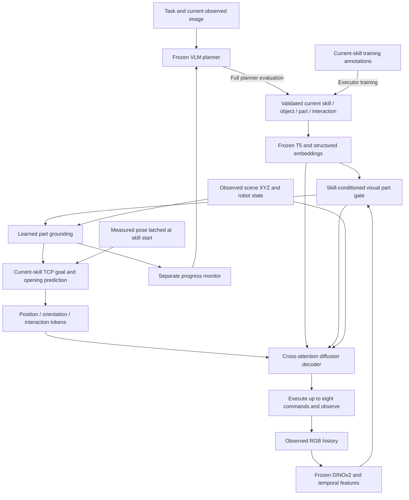

# Hierarchical Part-aware Pose Diffusion — v3

Implemented November 18, 2026 for Part2Action / PartGym, with independent
checkpoint identity `pose_token_diffusion_v3`. Earlier model sources, settings,
checkpoints, and results are preserved.

The first training condition supplies **annotated current skill instructions**
from demonstrations and uses predicted geometric goals. This tests the executor,
not VLM planning or physical task success. It is not a novelty claim.

## Current diagnostic status — November 22 (no jobs queued November 24)

The restart completed all **10 epochs / 19,900 optimizer updates**. The final
12-scenario development evaluation scored grasp 2/4, touch 1/4 and full
grasp–lift–reorient 0/4 under both learned and simulator-checked progression.
These small development results do not establish an advantage over a baseline.

The epoch-10 checkpoint is now frozen for a separate single-scene grasp probe:
mug episode 90492, object 8607, left-part grasp, reset seed 42.
Reference array **6965225** runs released-demo replay and native expert checks;
ordinary predicted-pose v3 evaluation **6965226** can run alongside them.
Verified-pose evaluation **6965227** waits for both reference checks; combined
report **6965228** follows all conditions. All jobs are evaluation only.

A reference must pass native target-grasp checking and a separately scored
5 cm lift/hold with measured object rise, contact persistence and relative
stability. Otherwise the verified condition records `blocked`, not a policy
failure. Both references use the same evaluation controller gains; the native
planner's requested gains and the replay's historical-gain limitations are logged.
Reference selection prefers eligible replay, then eligible native execution,
independently of the policy outcomes.

The verified arm replaces only pose-head position/orientation/opening through
an external diagnostic hook. It retains learned applicability/skill fields,
RGB/scene/robot/skill encoding, grounding, pose tokens and diffusion decoding.
Simulator object pose updates the explicitly privileged, verified object-relative
grasp target; it does not enter other model features. Policy source/checkpoint
hashes are checked, gradients are disabled and no training occurs. Both policy
arms use A16 GPUs and shared per-prediction diffusion noise. New control rollouts
need not reproduce the previous global-RNG trajectories.

The new hook/geometry/retention and storage checks passed **15 tests**. See the
[queued frozen grasp probe](../../results/diagnostics/pose_token_diffusion_v3_frozen_grasp_probe_20261122_01/README.md)
for jobs, fixed protocol, per-command TCP/orientation/finger/contact traces,
videos, reference gating and limitations. Frozen inference interventions can
shift the input distribution; this one-scene study narrows failure causes.

### Frozen probe outcome and geometry-gate follow-up

The reference replay passed native grasp and retained a roughly 4.4 cm lift.
Both frozen policy conditions failed to grasp, including verified geometry with
the learned applicability multipliers retained. Their initial physical states,
RGB/point-cloud hashes and policy weights matched. Supplemental native reference
retry **6965283** also passed grasp/lift validation after constructing its planner
before logger attachment; the earlier native check had failed when parser copying
encountered an open log handle. Original logs/results are preserved.

The verified-geometry test does not establish that fully trusted GT guidance
fails: its learned position/orientation multipliers fell to approximately
0.0102/0.0120 at the last prediction. These are token-suppression factors, not
calibrated pose-quality probabilities. Suppression may follow drift, so its
causal contribution remains untested.

Array **6965301** (completed November 22) ran two extra frozen evaluations on the same mug scene:
predicted geometry and verified geometry, each with the position/orientation
multipliers forced to one. Opening confidence, validity masks, skill identity,
visual/scene features and all policy weights remain unchanged. The validated
reference is reused. **Outcome:** neither predicted nor verified geometry grasped the mug with the
multipliers forced to one, so all four geometry/gate combinations failed while
reference replay succeeded. At the end of both forced-gate trials the fingers
were still nearly fully open. One scene and seed narrow the cause but do not
isolate it. Report **6965302** combines these with the prior learned-gate
controls and checks matching checkpoints, states, observations and GPU type.
See the [geometry-gate probe](../../results/diagnostics/pose_token_diffusion_v3_geometry_gate_probe_20261122_01/README.md).
The updated diagnostic checks passed **9 tests**; no training was submitted.

Earlier positive GT results belong to a different experiment: a pretrained
original visual policy was jointly fine-tuned with supplied GT conditioning on
the full four-category data. On 333 completed matched grasp cases, the historical
120/1 protocol measured initial-phase-end part grasp at 114/333 without GT and
160/333 with GT; six unavailable GT references remained coverage gaps. These
contact-based outcomes do not prove retention. V3 instead starts trainable weights
fresh on a 256-demo subset, uses predicted poses during training, and the present
probe replaces geometry only at inference under a different protocol. The
[older paired report](../../results/diagnostics/visual_oracle_pose_20261110_01/README.md)
and this single-scene probe are not matched architecture comparisons.

## Purpose and staged experimental plan

We want the robot to execute a part-specific interaction through an explicit
connection between **the current skill, the relevant object part, a geometric
goal, and an action sequence**. For example, grasping a mug handle and then
lifting it require different goals and interaction requirements. V3 should
eventually choose and execute these skills from the task and observations.

We first test whether the executor can perform a requested skill when the
semantic instruction is correct. This separates execution failures from errors
in task decomposition, object/part selection, or choosing the next skill.
The later planner experiment tests those decisions as part of the full system.
Neither stage's performance has been established by implementation checks.

### Stage 1: train the executor with annotated current skills

The demonstration annotations identify the active skill at each recorded
observation. The dataset converts that current instruction into a `SkillSpec`
containing the skill, object/part binding, and interaction requirement. The
executor uses that specification together with observed RGB/scene geometry and
measured robot state to predict a target TCP pose and an action chunk.

This is **supplied current-skill supervision**, sometimes described as an
oracle-skill or known-phase training condition. The annotation determines which
skill a training frame belongs to. It does not execute an oracle controller or
provide a live physical completion checker. Demonstrated target poses and part
labels supervise losses; the action decoder receives the model's own predicted
pose, not the demonstrated target pose.

All trainable executor and progress-monitor components start from random
weights. DINOv2 and Flan-T5 remain pretrained and frozen. The VLM planner is not
called or trained in this stage. Progress supervision uses the separately
audited annotation-boundary/endpoint proxies described below.

### Stage 2: diagnose execution and progression with supplied skills

Test single skills first, then short sequences such as grasp-to-lift. The
`--planner supplied-plan` evaluator supplies the known semantic skill list.
For a sequence, its current implementation advances that list only when the
**learned progress monitor** requests a completion review. Periodic review or
timeout does not itself advance the supplied list.

This mode supplies the intended plan but **does not supply the true live phase
or oracle physical completion**. The monitor can miss or trigger a transition
prematurely. The existing runner does not use demonstration timestamps or
simulator success predicates to select the active skill. The separate
phase-progression diagnostic below adds an explicitly privileged comparison;
it does not change this supplied-plan mode or the training recipe.

Measure native skill/task outcomes, grounding and goal errors, and progression
mistakes. Supplied-plan results characterize the executor with privileged
semantic information; report them separately from predicted-planner results.

### Stage 3: replace the instruction provider with the actual planner

Connect the frozen VLM planner to the same `SkillSpec` interface. It receives
the task, current image, measured TCP/opening, execution history, and progress
estimate, then chooses the current skill, object, part, and interaction.
The executor still grounds the part, predicts the geometric goal, and generates
actions. The interface remains the same while the source of the specification
changes from annotations/supplied plans to VLM predictions.

Initially retain the trained executor checkpoint and evaluate the complete
pipeline. Planner review can retain or revise a skill; a readiness estimate
does not guarantee that the physical interaction succeeded. Planner mistakes
and instruction-distribution differences may reduce execution performance.
If needed, later adaptation can use planner-generated instructions paired with
validated demonstration/action supervision; this is a proposed follow-up, not
an implemented training mode or a guaranteed improvement.

| Condition | Who supplies the current skill? | Who decides progression? | What does it establish? |
| --- | --- | --- | --- |
| Executor training | Demonstration annotation at the recorded frame | Offline annotation boundaries define training segments | Learning to execute a supplied skill; no planner-performance result |
| Supplied-plan simulator diagnostic | Known skill list | Learned monitor requests advancement of that list | Execution and progression under a privileged semantic plan |
| Full planner evaluation | VLM prediction from task and observations | VLM reviews the skill using observations and monitor/periodic/timeout requests | Performance of the complete planner–executor pipeline |

The initial annotated-skill recipe and both evaluator interfaces are implemented.
Training quality and simulator/VLM performance require their own runs. The
stages are an experimental sequence, not an automatic switch during an epoch.
The diagram below shows alternative annotation and VLM instruction providers;
they are not supplied together during full planner evaluation.

### Storage and run status update — November 19

Job **6957500 failed during epoch 3** after saving epoch-1 and epoch-2
checkpoints. Its dependent phase evaluations did not run. The failure log does
not establish the cause; quota is not a confirmed diagnosis. The ten-epoch
budget below remains the intended experiment, not a completed result.

Run artifacts now physically reside under `/p/part2action/results/`, with old
repository paths retained as browsing links. New v3 entry points enforce project
result/cache locations and Slurm log paths. See the
[storage cleanup](records/storage_cleanup_20261119.json). The recorded jobs below are
historical; storage-related source changes require a new matching smoke receipt
before restarting. No recovery run is implied by this cleanup.

### Immediate next experiment — November 19

Evaluate the latest fully saved **epoch-2 checkpoint** before changing the
architecture or retraining. Array **6958543** compares learned progression with
simulator-checked progression on the same 12 scenarios per condition; paired
report **6958544** follows it. Both retain vision, predicted geometric goals,
the same weights and the native 250-command / eight-command cadence. The
simulator checker changes only skill advancement, not the pose input.

This explicitly selected checkpoint comes from an interrupted run, not a
finished ten-epoch experiment. Preparation checked its completed-history entry
and reviewed the four storage-only source changes against saved snapshots.
See the [epoch-2 diagnostic](../../results/diagnostics/pose_token_diffusion_v3_phase_epoch2_20261119_01/README.md).

**Evaluation retry:** both tasks of array 6958543 failed before any robot trial
because the simulator's separate `t5-small` encoder was missing from the project
cache. Its existing cached files have now been copied and hash-verified on
project storage. CPU import check **6959357** gates retry array **6959358**;
report **6959359** follows. Policy weights and implementation are unchanged.
The old report is incomplete with zero matched trials, not a zero-success model
result. See the [retry record](../../results/diagnostics/pose_token_diffusion_v3_phase_epoch2_20261119_retry01/README.md).

An oracle-progression gain would support investigating progress detection;
failure in both arms would leave execution, grounding, pose targets and limited
training unresolved. Single-skill grasp/touch trials help inspect the executor
without a phase transition. Do not tune on these outcomes and report them as a
reserved benchmark.

A fresh ten-epoch restart with the same demonstration split is now **submitted**:
GPU recovery smoke **6959384** gates training **6959385**. This starts the
trainable policy from random weights, retaining frozen pretrained DINOv2/T5.
It does not warm-start from the old epoch-2 model-only checkpoint. Final-epoch
phase preparation **6959386**, evaluation **6959387**, and report **6959388**
follow training. Current completed epochs must be read from its history, not
inferred from the configured ten-epoch budget.

The earlier pending retry array/report 6959358/6959359 were cancelled before
execution when recovery code changed their source manifest. Native simulator
import check **6959357 passed** after restoring its separate T5-small cache.
A freshly source-locked epoch-2 comparison **6959390**, report **6959391**,
follows the GPU recovery smoke and retains identical inference weights and
runtime. See the [updated epoch-2 evaluation](../../results/diagnostics/pose_token_diffusion_v3_phase_epoch2_recovery_20261119_01/README.md).

### Training failure investigation and recovery — November 19

Original job 6957500 exited 1 during epoch 3, after the last logged step 1750.
Slurm reported neither timeout nor OOM; peak host RSS was about 5.2 GiB against
32 GiB requested, and the last recorded losses were finite. Its stderr contains
startup warnings and no traceback. Current home/project quota snapshots are
62%/42%; they do not establish historical quota use or the crash cause. The
specific original cause remains unknown. A CPU data audit **6959389** re-reads
original epoch-3 batches 1701–1800 and their progress queries to test for
reproducible input/HDF5 failures; it does not reconstruct the missing optimizer
or GPU RNG state.

New training entrypoints activate diagnostics before importing the trainer:

- Atomic, flushed heartbeat and exception records include epoch, step, sample
  identities, peak host RSS and CUDA memory use. Full Python tracebacks and
  native-fault/stall stack dumps have separate files on project storage.
- The batch shell independently records its exit status. SIGTERM/SIGUSR1 are
  captured when delivered to Python; SIGKILL or node loss cannot be caught.
- Worker data fetches have a 180-second timeout so stalls produce an exception.
- Every completed epoch atomically saves model, optimizer, Python/NumPy/Torch/
  CUDA RNG, loader generators, progress-sampler state and history, keeping the
  previous recovery snapshot. Recipe, source, manifest and initialization
  checks prevent silently resuming an incompatible experiment.
- Shuffle RNG is separate from worker-start RNG. Current dataset reads and
  labels are deterministic; this preserves the next epoch's order when workers
  restart. Resume replays an incomplete epoch from the last saved boundary.
  Later stochastic data augmentation would require an explicit recovery review.

Recovery files are `train/training_latest.pt` and
`train/training_latest_previous.pt`. The existing `epoch_###.pt` files remain
inference checkpoints. Old model-only files cannot exactly resume training.
Incomplete later-epoch artifacts are archived on resume, rather than overwritten.
Use the same study with `MODE=resume` and `RESUME_STATE` pointing to its full
training snapshot. All inference/model-forward blocks remain unchanged.

The recovery and v3 regression suite passed **43 tests**, including a save/load
comparison reproducing the exact next CPU optimizer update. GPU smoke also
requires an optimizer/CUDA-RNG roundtrip before full training may start. The
failed original node is excluded as a precaution, without claiming a node fault.
See the [recovery study](../../results/diagnostics/pose_token_diffusion_v3_10epoch_restart_20261119_01/README.md).

### Ten-epoch training and phase-progression diagnostic — November 18

The current training budget is **10 epochs**, with batch size 16 and AdamW learning rate
1e-4: 226 training demonstrations / 31,837 observations and 30 whole held-out
demonstrations / 4,444 observations across bottle, mug, pliers, and scissors.
This is about **19,900 optimizer updates**. Training starts with fresh trainable
policy weights; pretrained DINOv2/Flan-T5 remain frozen. No previous v1/v2
policy checkpoint is loaded. Held-out component validation runs at epoch zero
and after each epoch, with checkpoints saved after epochs 1 through 10.

The earlier two-epoch job **6957455** was stopped during its first epoch, and
its dependent phase-evaluation jobs were cancelled. Its artifacts are preserved
in the [superseded pilot](../../results/diagnostics/pose_token_diffusion_v3_implementation_20261118_01/README.md).
The longer run starts fresh because policy checkpoints do not contain optimizer
state. Matching GPU smoke **6957499** gates training job **6957500**; the previous
implementation smoke passed, but its receipt belongs to the older recipe.

Ten epochs are a development budget, not a convergence guarantee. Inspect the
held-out execution/goal/progress trends before drawing performance conclusions.
Training with annotated skills alone cannot establish that runtime progression
is the bottleneck.

After training, compare the **same epoch-ten checkpoint** under:

| Condition | Supplied semantic plan | Skill advancement |
| --- | --- | --- |
| Learned progression | Known skill list | Existing learned progress-monitor review |
| Oracle progression diagnostic | The same known skill list | Live simulator skill predicates at chunk boundaries, with the same minimum two-chunk gate |

The standalone
[`run_pose_token_v3_phase_diagnostic.py`](../scripts/run_pose_token_v3_phase_diagnostic.py)
keeps this intervention outside the model/trainer. Both conditions use the same
12 held-out development scenarios, seed 42, observed inputs, predicted pose
goals, initial physical reset, 250-command budget and eight-command cadence.
This gives 24 rollouts: four objects with a grasp, touch, and lift-containing
sequence per object in each condition. No GT geometric goal is an actor input.
Only the oracle diagnostic uses privileged completion information to select
the next supplied skill. Simulator queries restore physics, clock, recording
state, parser caches, and random streams; they are never training inputs.

Preparation job **6957501** depends on training, evaluation array **6957502**
depends on preparation, and report job **6957503** follows evaluation. The
diagnostic now selects the configured final epoch instead of hard-coding epoch
two. See the
[training study](../../results/diagnostics/pose_token_diffusion_v3_10epoch_20261118_01/README.md)
and [phase-diagnostic study](../../results/diagnostics/pose_token_diffusion_v3_phase_10epoch_20261118_01/README.md).
Missing, errored, or physically mismatched resets remain explicit coverage gaps.

An oracle-progression gain suggests that progression limits this checkpoint
under the simulator's predicates. Failure in both conditions leaves execution,
grounding, goal prediction, or insufficient training unresolved. Native grasp
contact does not establish secure retention, and these small, single-seed
development results do not establish a general or unique bottleneck. They are
separate from later VLM-planner evaluation and reserved benchmark comparisons.



## Changes from v2

- No internal skill-plan decoder or phase selector. The encoder accepts one
  validated `SkillSpec`. T5 encodes its current instruction and object/part
  binding. Skill, interaction, direction, and optional instruction-specified
  distance also have explicit trainable representations.
- A skill-conditioned visual gate and learned scene-point grounding provide
  part features to goal prediction and action generation. Names alone are not
  localization. GT part masks/clouds and future poses are never actor inputs.
- A current goal replaces the learned-phase goal bank. Move targets are
  displacements from a latched measured skill-start pose. Contact targets are
  residuals around the grounded part. Semantic review of the same step keeps
  its anchor while geometry refreshes at every action chunk.
- A separate progress MLP requests planner review; it never increments a hidden
  phase. Periodic review and timeout also request a decision. Readiness is not
  verified physical completion.
- Action labels pair observation t with command t+1, are masked at skill
  boundaries, and include short/tail observations. Padding never contains a
  later skill's commands. Endpoint observations have no fabricated action loss.
- Touch opening is supervised from demonstrated commands, in addition to its
  geometry proxy. Proximity alone does not establish physical contact.

Stable geometry, point encoding, backbone loading, pose tokenization and
transformer diffusion blocks are reused as new instances. No v1/v2 policy
weights are loaded. `max_skill_slots` limits annotation arrays only; the v3
executor generates no slot plan.

## Training and labels

Trainable policy components start randomly. DINOv2 ViT-S/14 with registers and
`google/flan-t5-base` are pretrained and frozen. Both are cached locally:
**no new model download is needed for this pilot**.

Pose labels remain demonstrated TCP references used only in losses. Grounding
labels currently apply to grasp/touch target parts. Later TCP endpoints and
touch distances are proxies, not object-pose/contact/support verification.
The action decoder always uses its own predicted geometric goal.

Progress supervision reuses the audited v2 boundary/endpoint queries, including
terminal observations and post-transition queries about the preceding skill.
Four balanced progress-only observations are added per update. Incomplete final
chains are masked. Complete-chain endpoints are explicitly weak proxies because
the HDF5s lack physical-success flags. Reports separate their sources.

Whole demonstrations are held out. Reusing the v2 manifest matches demonstrations,
not frame counts, updates, labels, or compute: v3 changes tail sampling and skill
conditioning. Its pilot alone cannot attribute gains to an individual component.

Prepare without submitting or downloading:

```bash
PYTHONPATH=part2action:part2action/scripts \
  /p/part2action/envs/part2action_train/bin/python -B \
  part2action/scripts/run_pose_token_diffusion_v3.py \
  --out-dir results/diagnostics/MY_V3_STUDY \
  --reference-manifest results/diagnostics/pose_token_diffusion_v2_pilot_20261116_01/demonstrations.json
```

Submit `slurm/pose_token_diffusion_v3.sbatch` with absolute `STUDY` and
`MODE=smoke` or `MODE=train`. Training requires a successful GPU smoke receipt
for the exact recipe, manifest and source hashes, with identical initialization.
Readable Markdown, per-observation CSV, per-skill/per-object JSON, coverage,
progress recall/false positives, source snapshots and initialization are saved.

## Planner and deployment

`planner.py` implements strict JSON and a lazy frozen adapter for
[`Qwen/Qwen3-VL-4B-Instruct`](https://huggingface.co/Qwen/Qwen3-VL-4B-Instruct).
The adapter requires downloaded weights and a pinned 40-character commit
revision. It never implicitly downloads or installs anything. Actual Qwen
generation remains a separate check once weights are available. The cached
text-only Qwen3-4B checkpoint is not this vision-language model.

An execute decision has `status: execute` and a `skill` object containing:
`kind`, `instruction`, `object_ref`, `target_part`, `interaction`, `direction`,
`distance_m`, and `step_id`. A valid example is grasp_obj / "Grasp the mug at its
handle" / mug / handle / close / unspecified / null / grasp_0. Unsupported
fields, including metric poses, are rejected. Distance is optional instruction
conditioning, not a VLM-generated metric pose.

`HierarchicalRolloutPolicy` refreshes goals each chunk and requests semantic
review after eight chunks, readiness after at least two chunks, or a 32-chunk
skill timeout. These are initial settings to validate. A repeated step ID keeps
its reference; a new step starts a new skill/retry. `done` and `uncertain` stop
execution without assigning physical success.

`scripts/evaluate_pose_token_diffusion_v3.py` is an independent PartGym runner
using a pinned development scenario plan and the shared 250-command/eight-command
protocol. It scores native `info['Success']` only. Choose `--planner qwen
--planner-revision COMMIT`, or the explicitly privileged `--planner supplied-plan`
diagnostic. The supplied plan advances only on learned monitor review, with no
oracle physical predicate. It is not a VLM result. V1/v2 runners are unchanged.

## Checks and remaining experiments

```bash
PYTHONPATH=part2action:part2action/scripts PYTHONDONTWRITEBYTECODE=1 \
  /p/part2action/envs/part2action_train/bin/python -B -m unittest discover \
  -s part2action/models/pose_token_diffusion_v3/tests -v
```

`tests/check_real_data.py` audits real annotations and runs a production-width
CPU update using tiny frozen test encoders and four sampling steps. GPU smoke
uses actual pretrained backbones. Neither is a task-success evaluation.

Still to establish: reliable skill execution, simulator behavior, sequence
progression, real VLM planning quality/latency, matched pose/T5 ablations, and
reserved benchmark performance. Persistent held-part/orientation-target bindings,
verified retention, object-pose estimation and multi-object relations are deferred.

See the separate [hierarchical proposal](HIERARCHICAL_POSE_POLICY_PROPOSAL.md).
