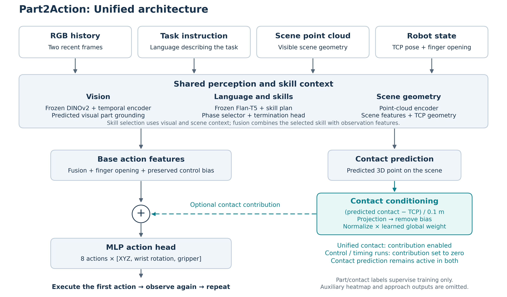

# Part2Action research update — October 12, 2026

Seven-slide meeting deck. Use six to seven slides for future decks by combining
related sections; omit speaker notes and dash bullets.

Media: [preview](media/2026-10-12/index.html) · [download bundle](media/2026-10-12/2026-10-12_slide_media.zip).

## Slide 1 — Part2Action: Contact-conditioned policy

Old near-contact policy: within 3 cm, switch XYZ to contact plus a bounded offset.
Unified policy: condition one action head on predicted TCP-relative contact throughout motion.
Retain two frames, visual part grounding, the skill hierarchy, and eight-action chunks.
Normalize contact-dependent features and learn one global weight, shared across frames and tasks.
The weight decreased from 0.01 to 0.00435 in the 10-epoch normalized continuation; it is not distance-dependent.
Question: does explicit contact information improve manipulation?

Architecture: [PNG](media/2026-10-12/slide04_unified_architecture.png) · [SVG](media/2026-10-12/slide04_unified_architecture.svg).
Optional illustration: [Expert demonstration with contact and TCP overlays](media/2026-10-12/slide01_bottle_neck_contact_demo.gif).

## Slide 2 — Part2Action: Contact localization

Predicted contact points were about 1 cm from the intended part at reset.
This measures prediction accuracy, not hand distance or gate activation.
A nearby point does not guarantee correct orientation, closing, or task success.

Baseline: one frame; contact prediction is auxiliary only.
Near-contact: two frames; within 3 cm, XYZ switches to contact plus a bounded offset.
Unified control: two frames; explicit contact input disabled.
Original unified contact: two frames; predicted geometry feeds the action head additively.

| Model | Mean contact-to-part distance at reset | Trials within 3 cm |
| --- | --- | --- |
| Original baseline | 0.96 cm | 37/39 |
| Near-contact | 1.24 cm | 37/39 |
| Unified control | 1.00 cm | 37/39 |
| Unified contact | 1.27 cm | 36/39 |

Table image: [PNG](media/2026-10-12/slide02_contact_localization_table.png).
Visual: [Expert → original control → original contact](media/2026-10-12/slide02_original_contact_localization.gif).
Evidence: [39 initial observations per original 30-epoch model](../../../results/diagnostics/contact_motion_20261008/reference_reports/contact_localization_20261008/summary.json).

## Slide 3 — Part2Action: Contact strength changes actions

Kept one additive-contact checkpoint fixed; changed only its contact input strength.
On identical observations, full contact changed XYZ by 36 cm and wrist orientation by 79° versus zero input.
Reducing contact improved approach distance, suggesting a problem in how actions use it.
Zero input here is an intervention on the same model, not a separately trained control.

| Contact input strength | Success | Mean TCP-to-part distance during rollouts |
| --- | --- | --- |
| 100% | 0/39 | 58.22 cm |
| 25% | 0/39 | 28.13 cm |
| 0% | 2/39 | 24.35 cm |

Table image: [PNG](media/2026-10-12/slide03_contact_strength_table.png).
Visual: [Expert → 100% → 25% → 0% contact](media/2026-10-12/slide03_contact_strength_100_25_0.gif).
All policies fail this example; their approach behavior differs.
Evidence: [Contact-strength measurements](../../../results/diagnostics/contact_intervention_20261008/summary.json).

## Slide 4 — Part2Action: Contact and motion failures

Control: contact prediction is auxiliary; its explicit action contribution is disabled.
Contact: normalized predicted geometry and the learned global weight influence actions.
Both use the same two-frame MLP and 10 extra epochs from the same 30-epoch control checkpoint.
Similar contact accuracy did not translate into better task success.

| Metric | Control | Contact |
| --- | --- | --- |
| Successful trials | 4/39 (10.3%) | 0/39 (0%) |
| Reached within 10 cm of the first target part | 19/39 | 18/39 |
| Mean predicted-contact-to-part distance during motion | 3.19 cm | 3.25 cm |

Touch trials stayed within 5 cm of the initial TCP in 15/18 control and 16/18 contact rollouts.
All 21 grasp-starting trials per model moved more than 5 cm.
The action head also predicts gripper opening, bounded to 0–0.04 m per finger at execution.
Diagnose approach initiation separately from grasp pose and closure.

Table image: [PNG](media/2026-10-12/slide05_normalized_results_table.png).
Visuals: [Mug grasp](media/2026-10-12/slide05_normalized_mug_grasp.gif) · [Stalled mug touch](media/2026-10-12/slide06_stalled_mug_touch.gif).
Evidence: [Historical 39-rollout results](../../../results/part2action/evaluations/normalized_global_20261010/summary.json) · [Motion traces](../../../results/part2action/evaluations/normalized_global_20261010/motion_diagnostics.json).

## Slide 5 — Part2Action: Recording order and action alignment

In all 4,053 valid demos, first approach motion shared its saved index with the command.
Eight CPU prefix replays confirmed post-action observations at the tested transitions.
Stride 2 skipped the preceding observation in 1,575 demos.
The released loader also uses same-index labels; shifting targets is a hypothesis, not proof of a loader bug.

| Saved observation | Same-index target | Next-action target |
| --- | --- | --- |
| Frame 15, still waiting | Continue waiting, action 15 | Begin approach, action 16 |
| Frame 16, already moving | Approach, action 16 | Next command, action 17 |

Test two-frame MLPs with stride 1 and contact conditioning disabled.
Both receive 10 extra epochs from the same 30-epoch control checkpoint; only the action chunk shifts.

| Experiment | Observation history | Supervised action chunk |
| --- | --- | --- |
| Same-index | `obs[t−1], obs[t]` | `action[t] … action[t+7]` |
| Next-action | `obs[t−1], obs[t]` | `action[t+1] … action[t+8]` |

This tests continuation behavior; the additional from-scratch comparison is skipped.
Native touch-frame spacing remains unresolved; replay checks cover initial prefixes.

Table images: [Recording order](media/2026-10-12/slide07_recording_order_table.png) · [Action alignment](media/2026-10-12/slide08_action_alignment_table.png).
Visual: [Same recorded RGB with alternative action labels](media/2026-10-12/slide07_observation_action_timing.gif).
Evidence: [Timing audit](../../../results/diagnostics/observation_action_timing_20261010/timing_report.json).

## Slide 6 — Part2Action: Next-action targets improve pilot success

Matched two-frame MLP continuations with contact conditioning disabled.
Shifted targets from action t to action t+1 while retaining the same observations.
Next-action achieved 5/39 successes versus 1/39: a 10.3 percentage-point improvement.
Overall success remains low; validate this pilot result with expanded coverage.

| Action target | Successful rollouts | Success rate |
| --- | ---: | ---: |
| Same-index: observation t → action t | 1/39 | 2.6% |
| Next-action: observation t → action t+1 | 5/39 | 12.8% |

The five successes cover mug and pliers, three object–task combinations, and four unique episodes.
This is a continuation result, not a contact or diffusion comparison.

Table image: [PNG](media/2026-10-12/slide06_timing_results_table.png).
Visual: [Expert → same-index → next-action, mug example](media/2026-10-12/slide06_next_action_mug.gif).
Next-action succeeds and same-index fails in this example.
Evidence: [Pilot summary](../../../results/part2action/evaluations/action_timing_20261011/summary.json) · [39 comparison GIFs](../../../results/part2action/evaluations/action_timing_20261011/index.html).

## Slide 7 — Part2Action: Expanded evaluation and diffusion

Expanded evaluation covers all 149 four-object test1 scenarios at seeds 42, 43, 44: 447 rollouts per model.
Report per-seed success, mean, and sample standard deviation; test1 is not the complete four-object test suite.
Train two-frame diffusion control/contact policies from scratch for 30 epochs, using stride 2 and same-index targets.
The contact variant uses normalized-global conditioning; control disables the contact-dependent contribution.
Compare success, approach, grasping, and inference latency against MLP using expert-left GIFs.
Use failure traces to choose the next targeted fix; expand training categories separately.

Existing MLP contact references differ in conditioning or training history; their comparison is not decoder-only.
Evaluation seeds measure rollout randomness; each checkpoint still uses one training seed.

Results: [Expanded test1 folder](../../../results/part2action/evaluations/action_timing_full_test1_20261012/).
References: [Research plan](../RESEARCH_PLAN.md) · [Diffusion details](../archive/2026-10-22/DIFFUSION_ABLATION.md) · [Dataset splits](../DATASET.md).

## Evidence and run records

Normalized MLP: training6702333/6702334; evaluation6705020/6705021.
Timing MLP: training6705831/6705832; pilot evaluation6712177/6711750; paired export6712178.
Expanded test1: evaluation6714294/6714295; export6714296.
Diffusion: training6712229/6712230; evaluation not yet submitted.

[Timing training records](../../../results/part2action/runs/timing_submissions_20261010.json) ·
[Expanded evaluation records](../../../results/part2action/evaluations/action_timing_full_test1_20261012/submissions.json) ·
[Diffusion training records](../../../results/part2action/runs/diffusion_submissions_20261012.json).

Expert videos are task-matched references and may have different initial scenes.
Historical 39-rollout scores and expanded test1 scores have different task coverage.
