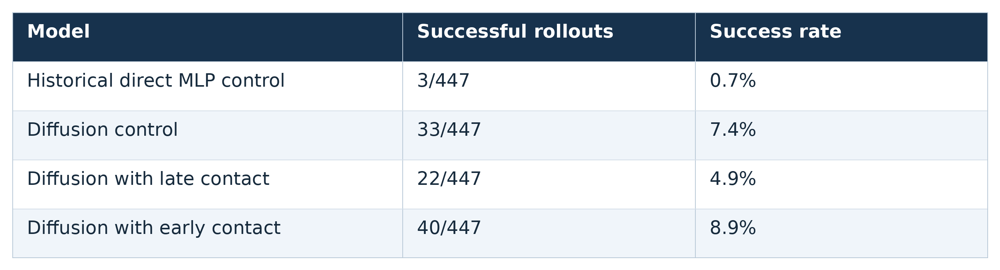
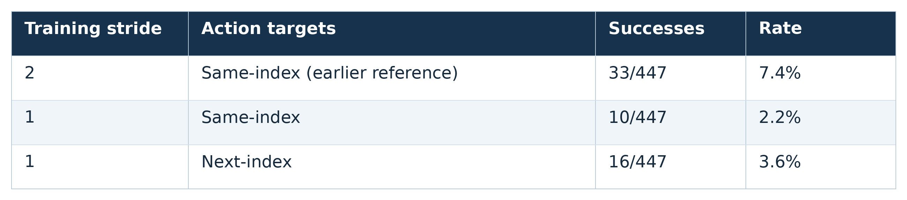
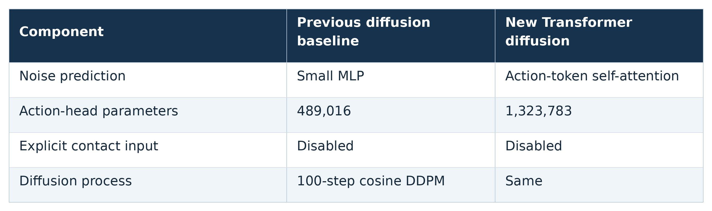
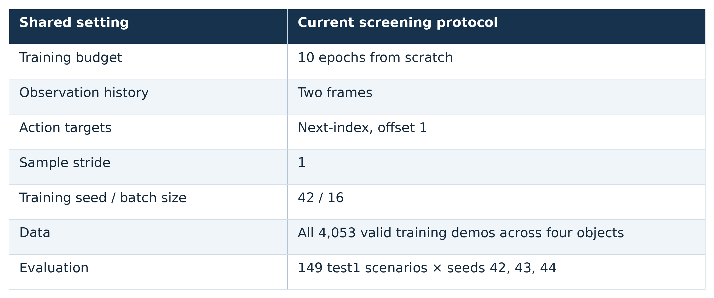
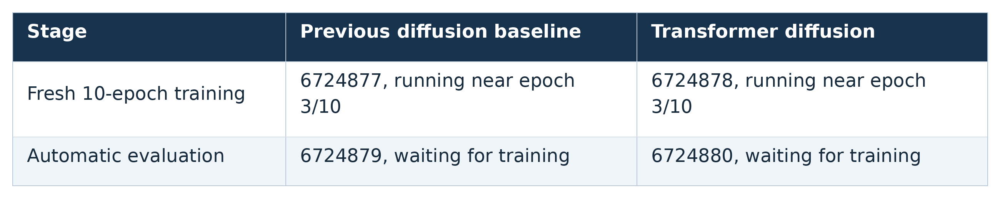

# Part2Action research update — October 19, 2026

Six-slide meeting deck. Status checked October 19; no speaker notes.

Slide media: [PNG preview](media/2026-10-19/index.html) · [download all table images](media/2026-10-19/2026-10-19_slide_media.zip).

## Slide 1 — Part2Action: Diffusion improves control

Completed 30-epoch models from scratch with two frames, same-index targets, and stride 2.
Evaluated 149 test1 scenarios at three seeds: 447 rollouts per model, with one training seed per model.
Diffusion improved control performance and is now our default action head; MLP-only results are archived.
Early contact achieved the highest aggregate score, but contact conditioning has not consistently helped.

Use this image: [slide01_diffusion_improves_control_table.png](media/2026-10-19/slide01_diffusion_improves_control_table.png).
Results: [Original decoder comparison](../../../results/part2action/evaluations/diffusion_30epoch_20261013/index.html) · [Early-contact comparison](../../../results/part2action/evaluations/diffusion_early_contact_20261018/index.html).

## Slide 2 — Part2Action: Earlier contact fusion

Move predicted contact from a late feature addition to an input token before temporal processing.
Remove the learned global scalar; retain coordinate scaling and LayerNorm.
Success: early contact 40/447, control 33/447, late contact 22/447.
Promising improvement, but upstream feature changes prevent isolating contact’s contribution.

Visuals: [Expert → diffusion control → late contact → early contact](../../../results/part2action/evaluations/diffusion_early_contact_20261018/index.html).

## Slide 3 — Part2Action: Timing and sampling

While comparing same-index and next-index targets, I inadvertently changed training stride from 2 to 1.
Both new runs used two-frame diffusion, 30 epochs from scratch, and no contact conditioning.
Next-index scored 16/447 versus 10/447 for same-index, but both trailed the earlier stride-2 control at 33/447.
Stride samples every step or every other step; it changes training examples and updates, not observation-frame spacing.
Next-index helped within this test; the stronger stride-2 reference motivates a separate controlled stride investigation.

Use this image: [slide03_next_index_targets_table.png](media/2026-10-19/slide03_next_index_targets_table.png).
Visuals: [Expert → same-index → next-index](../../../results/part2action/evaluations/diffusion_timing_scratch_20261015/index.html).

## Slide 4 — Part2Action: Transformer diffusion

Replace the small MLP denoiser with two Transformer layers and four attention heads over eight noisy action tokens.
Each token receives its action-step position, diffusion timestep, and existing pooled policy features.
Keep the vision/language encoders, observation-history encoder, hierarchy, part-mask gate, and action representation unchanged.
The comparison changes decoder architecture and capacity together; separate modality-token conditioning comes later.
CPU checks and real-data GPU preflights passed for both new training runs.

Use this image: [slide04_transformer_diffusion_table.png](media/2026-10-19/slide04_transformer_diffusion_table.png).

## Slide 5 — Part2Action: Faster comparisons

Temporarily reduce screening from 30 to 10 total epochs to shorten experiment turnaround.
Start each policy and optimizer fresh, with pretrained vision/language encoders frozen; no continuation from trained checkpoints.
Compare models at the same budget; short screening can miss slower-learning candidates.
Thirty epochs is not a proven convergence requirement; reserve longer matched training for selected candidates.
Cancelled the unused 30-epoch Transformer pipeline before training began.

Use this image: [slide05_faster_comparisons_table.png](media/2026-10-19/slide05_faster_comparisons_table.png).

## Slide 6 — Part2Action: Current runs and next steps

The 10-epoch next-index baseline and Transformer trainings are running; evaluations follow automatically.
GIF export 6724881 will produce expert → baseline → Transformer comparisons in one folder.
Compare task success by object and skill, approach behavior, grasp closure, and inference latency.
Use rollout videos to judge motion execution; training loss alone does not establish better task performance.
If the decoder helps, test richer modality-token conditioning; investigate early-contact gains with controlled input interventions.
Expert references may use different starting scenes and are not guaranteed to align by task phase.

Use this image: [slide06_current_runs_and_next_steps_table.png](media/2026-10-19/slide06_current_runs_and_next_steps_table.png).
Pending review: [10-epoch next-index decoder comparison](../../../results/part2action/evaluations/diffusion_screening_10epoch_next_action_20261018/index.html).
Run records: [Submission and configuration snapshots](../../../results/part2action/runs/diffusion_screening_10epoch_submission_20261018/submissions.json).
