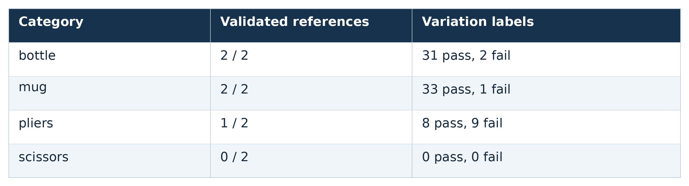
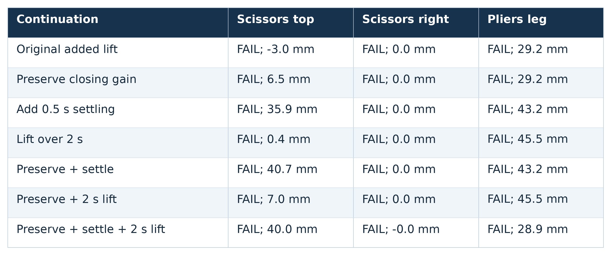
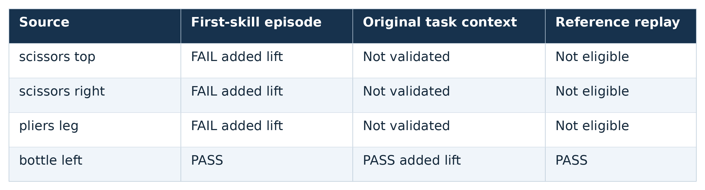
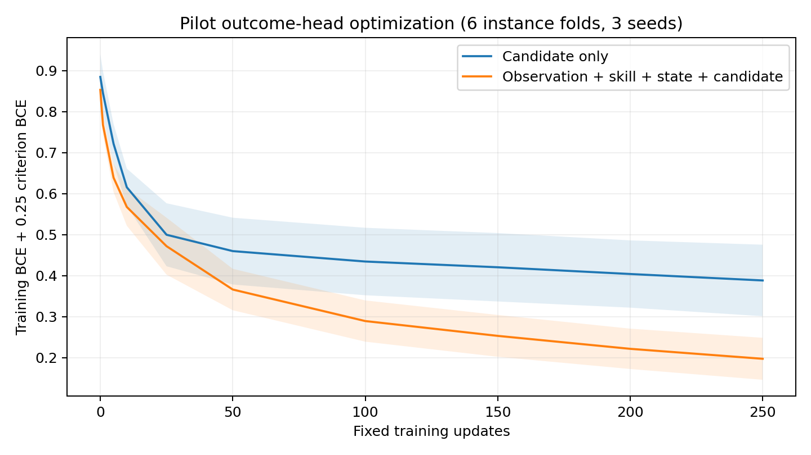
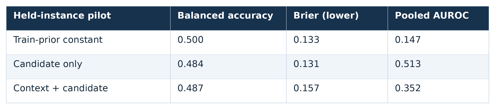

# Part2Action robustness and training update — November 2, 2026

Date: 2026-11-02

Report status: complete. Values are derived from linked execution records.

## Slide 1 — Part2Action: A reproducible collection pipeline

Generate fresh initial grasps with the released native expert.
Record actual motor calls, collision filters, physics cadence and physical outcomes.
Five of eight pilot references pass grasp/lift validation and exact replay.
The separate mug smoke also passes three exact replays.
These are newly generated references, not original expert task reproductions.

Use this image: [slide01_reference_validation.png](slide01_reference_validation.png).

## Slide 2 — Part2Action: Distinguish grasp detection from retention

All three rejected references pass the native instantaneous grasp check.
Two scissors grasps lose contact during our additional lift procedure.
The rejected pliers retains contact but rises 29.23 mm against a 30 mm criterion.
35 trials compare closing gain, settling and lift duration; no universal rescue.
Keep all physical success thresholds fixed; report each continuation separately.

Full-task termination context was audited separately; this remains our added lift test.

Use this image: [slide02_handoff_comparison.png](slide02_handoff_comparison.png).

Use this image: [slide02_native_context_comparison.png](slide02_native_context_comparison.png).

## Slide 3 — Part2Action: First outcome-head training completed

107 labeled executions: 92 success, 15 failure.
Six object instances; frozen DINOv2 and Flan-T5 features; full-scene point statistics.
Six instance-held-out folds, three seeds, 250 fixed updates per head.
Context reduces training loss, but held-out performance does not improve.
No action-policy training or candidate-selection rollout claim.

Use this image: [slide03_training_curves.png](slide03_training_curves.png).

Use this image: [slide03_predictor_results.png](slide03_predictor_results.png).

## Slide 4 — Part2Action: Evidence and next decision

Pilot variations yield both successful alternatives and failures.
Classifier training works technically; the current data do not support a generalization gain.
Only 15 failure labels exist, with nine from one pliers instance.
Keep continuation fixed while testing alternative native grasp proposals.
Expand object-instance coverage and failure diversity before larger policy training.
Test learned candidate selection against matched-data generic scoring.

Evidence: [machine-readable report](evidence.json).
