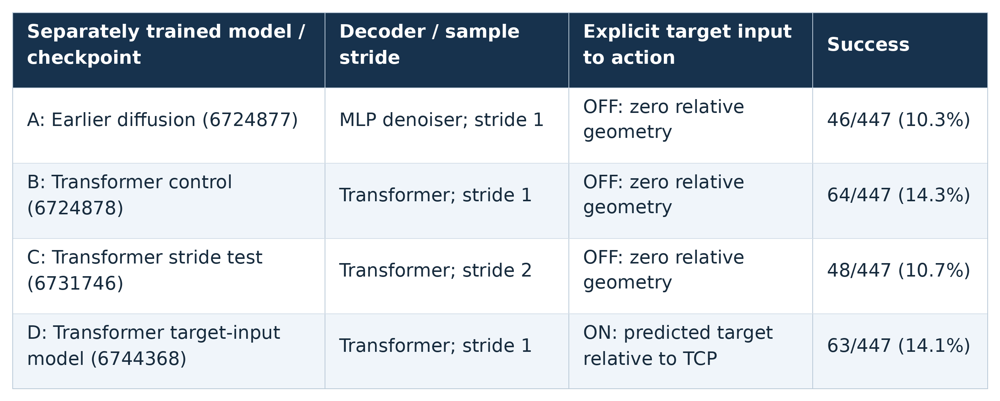
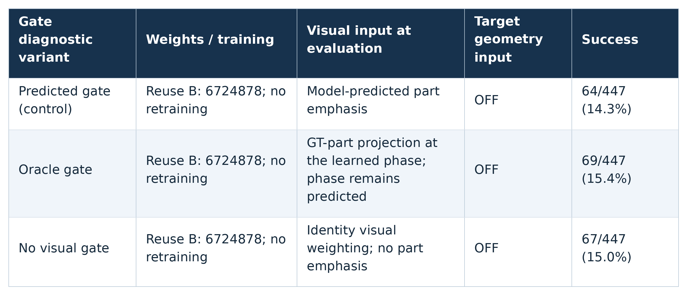
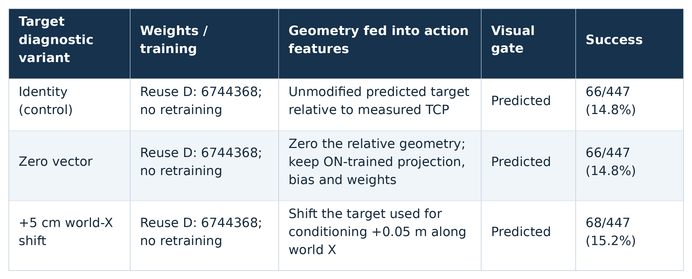
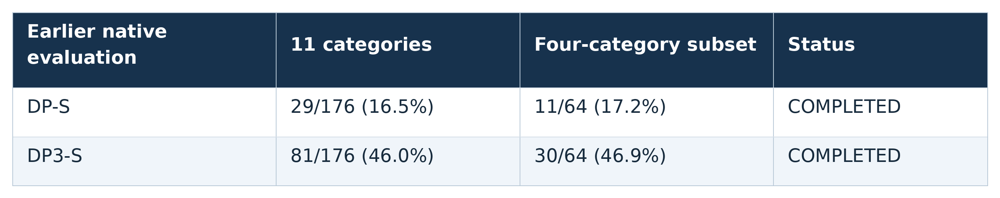
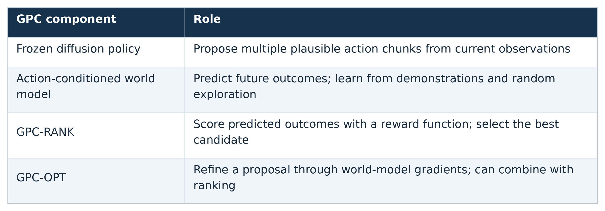
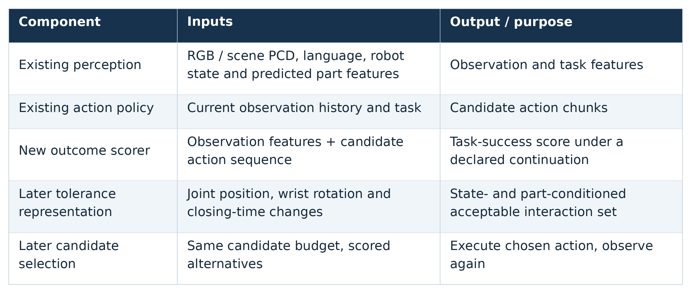
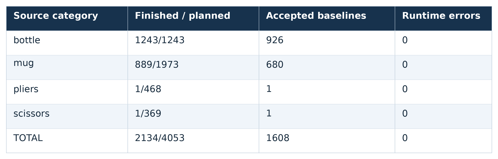
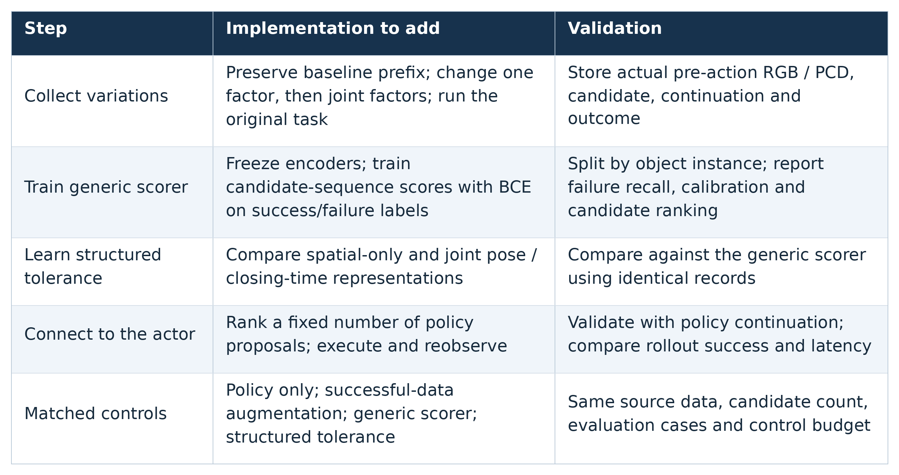
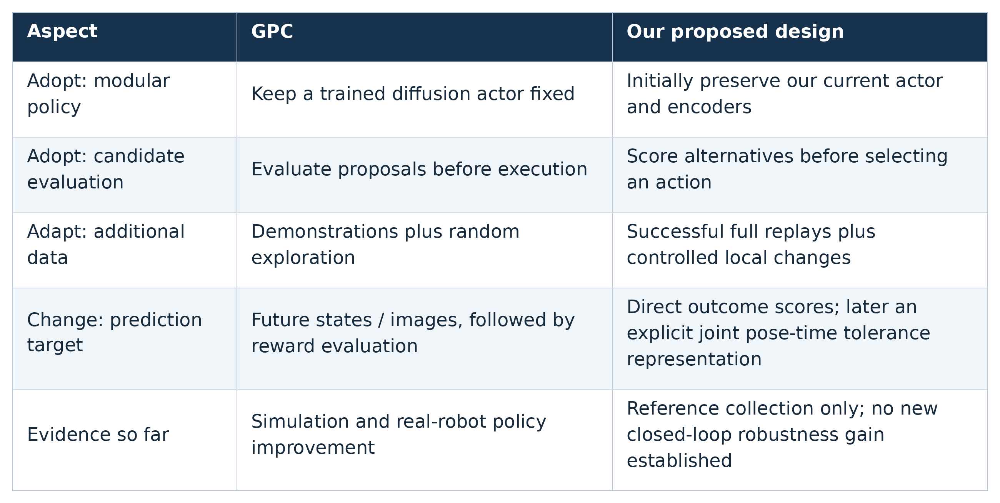

# Part2Action research update — November 2, 2026

Date: 2026-11-02

Seven slides; short presentation text followed by PNG tables; no speaker notes.
Evidence snapshot: 2026-11-02T10:32:39-05:00 (America/New_York). Running-job counts below are provisional.

## Slide 1 — Part2Action: Recovered policy results

All conditions use 447 fixed rollouts (149 scenarios x 3 seeds); ten-epoch models use one training seed.
A/B compare decoders; B/C compare sampling stride; B/D compare explicit target input using separate training runs.
Target input OFF/ON controls predicted target-to-TCP geometry entering the action features.
Target-head auxiliary loss and the predicted visual part gate stay enabled in all four training runs.
Frozen means reuse the same checkpoint without training; predictions and rollout states can still change.
Gate diagnostics reuse B in three conditions; target diagnostics reuse D in three conditions.
D scores 63 in standard evaluation and 66 in the separate identity run with different DDPM-noise handling.

Use this image: [slide01_recovered_policy_results.png](../media/2026-11-02/robustness_pilot/slide01_recovered_policy_results.png).

Use this image: [slide01_gate_diagnostics_detailed.png](../media/2026-11-02/robustness_pilot/slide01_gate_diagnostics_detailed.png).

Use this image: [slide01_target_diagnostics_detailed.png](../media/2026-11-02/robustness_pilot/slide01_target_diagnostics_detailed.png).

Sources: [Recovered OFF/ON](../../../../results/part2action/evaluations/diffusion_transformer_contact_comparison_20261027_recovery1/quantitative_report/summary.json) · [Gate diagnostics](../../../../results/part2action/evaluations/frozen_gate_diagnostics_20261022/quantitative_report/summary.json) · [Target diagnostics](../../../../results/part2action/evaluations/frozen_target_diagnostics_20261027_recovery1/quantitative_report/summary.json).

## Slide 2 — Part2Action: Released DP and DP3 references

Native evaluations are complete for DP-S and DP3-S: 176 trials per model.
The 64-trial four-category figures are subsets of those completed runs.
Protocol: 250 actions, eight-action execution blocks, GT part observations,
oracle skill progression and native sequential-skill scoring.

November 16 update: the superseded 120/1 fixed-reference outputs were removed
at the user's request. The native results are the retained reference.
These native sampled runs are separate from a complete fixed-scenario comparison.

Sources: [Native DP](../../../../results/partinstruct/evaluations/official_release_20261022/DP-S/full/summary.json) · [Native DP3](../../../../results/partinstruct/evaluations/official_release_20261022/DP3-S/full/summary.json).

## Slide 3 — Part2Action: GPC evaluates actions before execution

GPC: Inference-Time Enhancement of Generative Robot Policies via Predictive World Modeling.
IEEE Robotics and Automation Letters; accepted February 2026.
Keep the diffusion actor frozen and train an action-conditioned predictive world model separately.
Use predicted futures to rank or refine candidate actions at inference time.
GPC shows policy improvement in simulation and on real robots.
It motivates modular action evaluation; it does not validate our tolerance representation.

Use this image: [slide03_gpc_method.png](../media/2026-11-02/robustness_pilot/slide03_gpc_method.png).

Sources: [Uploaded paper](<../media/2026-11-02/robustness_pilot/Inference-Time Enhancement of Generative Robot Policies via Predictive World Modeling.pdf>) · [Official project](https://computationalrobotics.seas.harvard.edu/GPC/) · [Paper v4](https://arxiv.org/html/2502.00622v4).

## Slide 4 — Part2Action: Learn acceptable interaction alternatives

Proposed: learn which position, wrist-orientation and closing-time changes preserve task success.
Condition on the observed scene, target part, task and current robot state.
Keep the existing Transformer diffusion policy as the initial proposal generator.
Start with a generic candidate-success scorer; structured tolerance is the hypothesis to test.
Score candidates from actual pre-action observations; exclude post-action outcomes from inputs.
Do not require future expert poses or expert closing times at deployment.
The full-task scorer and tolerance-guided policy have not been trained yet.

Use this image: [slide04_proposed_tolerance_architecture.png](../media/2026-11-02/robustness_pilot/slide04_proposed_tolerance_architecture.png).

## Slide 5 — Part2Action: Implemented reproducible baseline collection

Replay every stored action once with native controller defaults and full task context.
Accept task-successful executions that repeat reliably at the same seed; HDF5 path matching is not a gate.
Technical preflight: five source pairs reproduced; 4/5 became successful baselines, with no runtime errors.
Screen all 4,053 valid demonstrations in our four training categories; two entries lack actions.
Native first-success events define task completion; add no lift or final-frame contact-hold test.
The table is a collection snapshot in inventory order, not a policy benchmark or multi-seed robustness result.

Use this image: [slide05_implemented_baseline_collection.png](../media/2026-11-02/robustness_pilot/slide05_implemented_baseline_collection.png).

Sources: [Study ledger](../../../../results/diagnostics/full_trajectory_baselines_20261102/current_study.json) · [Preflight](../../../../results/diagnostics/full_trajectory_baselines_20261102/preflight_v2/summary.json) · [First full replay and video](../../../../results/diagnostics/full_dataset_trajectory_replay_20261102/mug_demo_1/README.md).

## Slide 6 — Part2Action: Next implementation and validation

Collect supported perturbations around accepted full-task baselines before new model training.
Start with position/orientation; apply closing-time changes only to meaningful grasp windows.
Keep controller and continuation fixed within each comparison, then test joint changes.
Train the scorer on both outcomes; use successful variations only for the behavior-cloning control.
Hold out whole object instances and keep every source trajectory with all of its variations.
Validate under policy continuation before claiming an improvement in policy-controlled rollouts.
The old 107-record grasp/lift pilot uses different labels and stays separate.

Use this image: [slide06_remaining_implementation.png](../media/2026-11-02/robustness_pilot/slide06_remaining_implementation.png).

## Slide 7 — Part2Action: What we adopt and what must differ

Adopt the separation between action generation, additional outcome data and candidate evaluation.
Propose controlled local variation data and an explicit joint pose-time tolerance representation.
GPC already conditions on current observations; state conditioning alone is not a novelty claim.
Test whether part-aware structure improves held-out control beyond generic scoring and data augmentation.
Match training data, candidate budgets and rollout conditions; report success and latency.
Lower cost, improved generalization and closed-loop robustness remain unverified hypotheses.

Use this image: [slide07_gpc_adopted_and_different.png](../media/2026-11-02/robustness_pilot/slide07_gpc_adopted_and_different.png).

Evidence: [Snapshot](../media/2026-11-02/robustness_pilot/evidence.json) · [Table values](../media/2026-11-02/robustness_pilot/tables.json).
