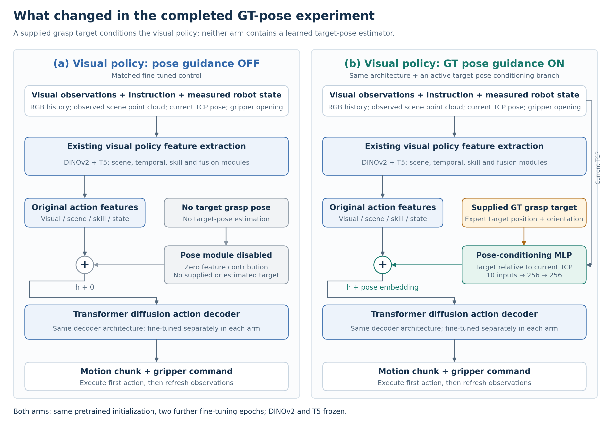
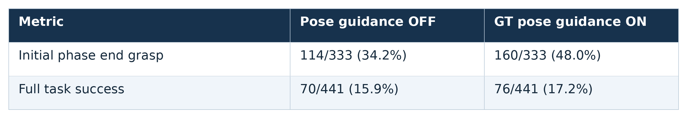
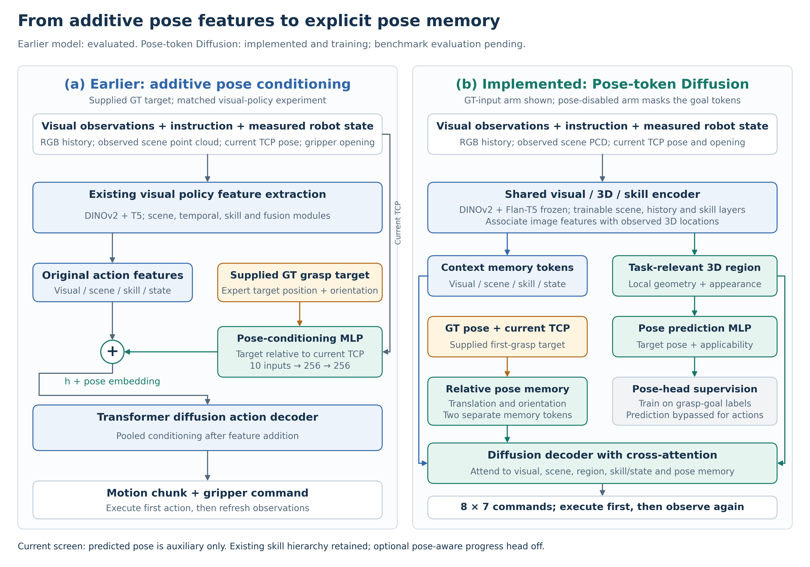
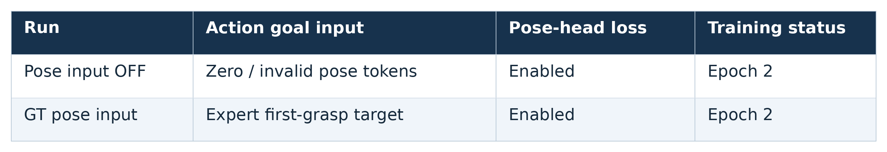

# Part2Action pose guidance and architecture update

Date: 2026-11-15

## Slide 1 — Part2Action: From contact points to grasp pose goals

The previous update covered contact-point guidance and proposed interaction tolerances.
A contact point supplies a location but leaves the desired gripper orientation implicit.
The new direction represents a grasp goal as a desired gripper position and orientation.
This is a target for the robot to reach, distinct from its measured current pose or the object's pose.
First question: does an accurate grasp goal help the existing visual policy?
We first supply ground-truth (GT) goals, then study predicting those goals from observations.

Sources: [Previous meeting update](2026-11-02_robustness_training_update.md) · [Contact-point limitations](2026-10-26_part2action_meeting_status.md).

## Slide 2 — Part2Action: The first GT pose experiment motivates a clearer interface

Since the previous update, we tested supplied GT grasp goals in the existing visual policy.
An MLP embedded relative position and orientation; its output was added to existing policy features.
Grasping improved, while full task success increased only modestly.
This motivates testing a clearer pose-to-action connection; the experiment does not isolate fusion as the cause.
441 matched case-seed pairs; 333 eligible grasp trials; six reference gaps excluded; one training seed and three evaluation seeds.
Native grasp means target-part contact with either finger and a closed command; sustained retention is not measured.

Use this image: [evaluated_pose_off_vs_gt_pose.png](../media/2026-11-15/architecture/evaluated_pose_off_vs_gt_pose.png). [Vector PDF](../media/2026-11-15/architecture/evaluated_pose_off_vs_gt_pose.pdf) · [Editable SVG](../media/2026-11-15/architecture/evaluated_pose_off_vs_gt_pose.svg).

Use this image: [slide02_previous_gt_pose_results.png](../media/2026-11-15/slide02_previous_gt_pose_results.png).

Sources: [Pose feature addition](../../../models/visual_pose_policy_v1.py) · [Relative pose embedding](../../../models/pose_conditioning_v1.py) · [Matched outcomes and coverage](../../../../results/diagnostics/visual_oracle_pose_20261110_01/summary.json) · [Evaluation scope](../../../../results/diagnostics/visual_oracle_pose_20261110_01/README.md) · [Editable table data](../media/2026-11-15/data/slide02_previous_gt_pose_results.json).

## Slide 3 — Part2Action: GHOST separates pose goals from actions

GHOST — Krishna et al., RSS 2026.
A high-level policy predicts an end-effector pose subgoal from visual observations and language.
A low-level policy generates robot actions conditioned on that subgoal and its observations.
The pose goal provides an explicit interface between deciding where to go and generating motion.
The figure also shows optional human-demonstration adaptation; our focus here is the goal-to-action separation.

Use this image: [ghost_fig01_overview.png](../media/2026-11-15/related_work/ghost_fig01_overview.png).

Figure excerpt: Krishna et al., *GHOST: Hierarchical Sub-Goal Policies for Generalizing Robot Manipulation*, RSS 2026, Figure 1, PDF page 1. [Original paper](https://arxiv.org/pdf/2606.10025v1#page=1) · [Local PDF](../papers/2026-11-15/GHOST_RSS2026.pdf#page=1).

## Slide 4 — Part2Action: GHOST gives the pose goal a spatial representation

GHOST represents the end-effector goal with gripper keypoints and projects them into camera images.
The projected points become heatmaps describing where the gripper should be in each view.
Camera images and goal heatmaps pass through separate ResNet encoders.
Their features combine with robot state to condition the diffusion policy.
The heatmaps make the spatial target explicit; the policy still learns how to reach it.
Design lesson: the representation connecting a pose goal to the controller matters.

Use this image: [ghost_fig06_goal_conditioned_policy.png](../media/2026-11-15/related_work/ghost_fig06_goal_conditioned_policy.png).

Figure excerpt: Krishna et al., *GHOST*, RSS 2026, Figure 6, PDF page 5. [Original paper](https://arxiv.org/pdf/2606.10025v1#page=5) · [Local PDF](../papers/2026-11-15/GHOST_RSS2026.pdf#page=5).

## Slide 5 — Part2Action: 3D Diffuser Actor connects scene and action tokens

3D Diffuser Actor — Ke et al., CoRL 2024.
RGB-D features are lifted into a shared 3D coordinate frame.
Scene information, language, robot state, and noisy future poses are represented as tokens.
3D relative attention connects these tokens while diffusion refines trajectory positions and rotations.
Here, pose tokens represent future actions being denoised, rather than a separate predicted grasp goal.
Design lesson: preserve spatial information and let action generation attend to it throughout denoising.

Use this image: [diffuser_actor_fig02ab_tokens_and_denoising.png](../media/2026-11-15/related_work/diffuser_actor_fig02ab_tokens_and_denoising.png). [Complete Figure 2](../media/2026-11-15/related_work/diffuser_actor_fig02_overview.png).

Figure excerpt: Ke, Gkanatsios, and Fragkiadaki, *3D Diffuser Actor: Policy Diffusion with 3D Scene Representations*, CoRL 2024, Figure 2(a-b), PDF page 4. [Original paper](https://arxiv.org/pdf/2402.10885v3#page=4) · [Local PDF](../papers/2026-11-15/3D_Diffuser_Actor_CoRL2024.pdf#page=4).

## Slide 6 — Part2Action: Pose-token Diffusion makes the grasp goal separate memory

Retain RGB history, observed scene points, language, measured TCP pose, and gripper opening.
Associate image features with 3D locations and ground a task-relevant region.
A separate MLP head predicts grasp position, orientation, and applicability.
Encode the selected goal as two TCP-relative memory tokens: translation and orientation.
Replace additive pose conditioning with a diffusion decoder that attends to scene, region, skill/state, and goal memory.
Generate eight motion/gripper commands; execute the first and refresh observations.

Use this image: [old_vs_implemented_pose_token_diffusion.png](../media/2026-11-15/architecture/old_vs_implemented_pose_token_diffusion.png). [Vector PDF](../media/2026-11-15/architecture/old_vs_implemented_pose_token_diffusion.pdf) · [Editable SVG](../media/2026-11-15/architecture/old_vs_implemented_pose_token_diffusion.svg).

Diagram: the current GT-input arm is shown; predicted pose is auxiliary in this screen. The existing skill hierarchy remains active; the optional pose-aware progress head is disabled.

Sources: [Model composition](../../../models/pose_token_diffusion/policy.py) · [Pose head](../../../models/pose_token_diffusion/blocks/pose_head.py) · [Relative pose tokens](../../../models/pose_token_diffusion/blocks/pose_tokens.py) · [Cross-attention action decoder](../../../models/pose_token_diffusion/blocks/action_decoder.py).

## Slide 7 — Part2Action: The running comparison tests the value of explicit pose input

Both arms use the new architecture with matched initialization, data order, auxiliary supervision, and training budget.
Both train the pose head; actions use supplied GT goal tokens or masked goal tokens, bypassing the head's predictions.
DINOv2 and Flan-T5 stay frozen; compatible pretrained policy weights are reused and new modules learn.
4,053 demonstrations and 502,431 samples; two epochs; batch 16; AdamW at 1e-4; BF16.
As of November 15 at 03:05 UTC, both runs are in epoch 2; new grasp/task benchmark results are pending.
Next: matched grasp/task evaluation, followed by studying action conditioning on predicted grasp goals.

Use this image: [current_training_comparison.png](../media/2026-11-15/architecture/current_training_comparison.png). [Editable table data](../media/2026-11-15/architecture/training_table.json).

Sources: [Dated training snapshot](../media/2026-11-15/data/slide07_training_snapshot.json) · [Matched run plan](../../../../results/diagnostics/pose_token_diffusion_training_20261114_01/plan.json) · [Model configuration](../../../models/pose_token_diffusion/configs/model.yaml) · [Training configuration](../../../models/pose_token_diffusion/configs/train.yaml) · [Shared auxiliary losses](../../../models/pose_token_diffusion/losses.py).
